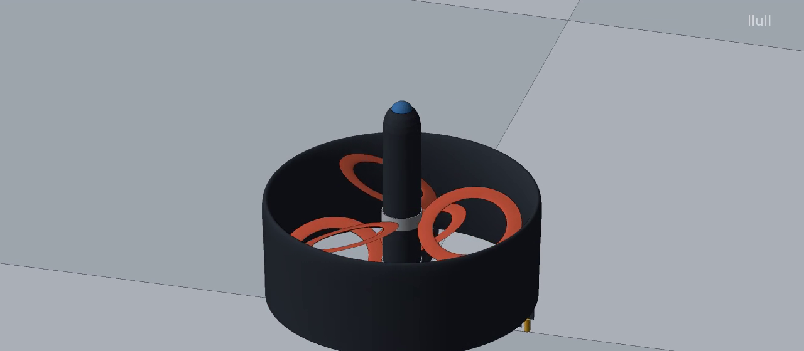
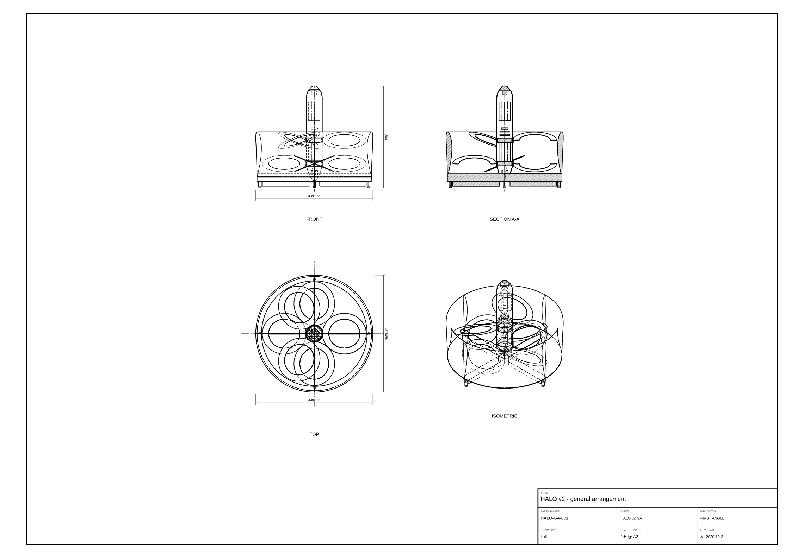
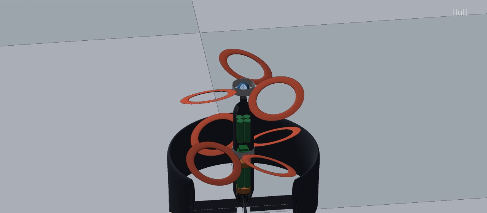
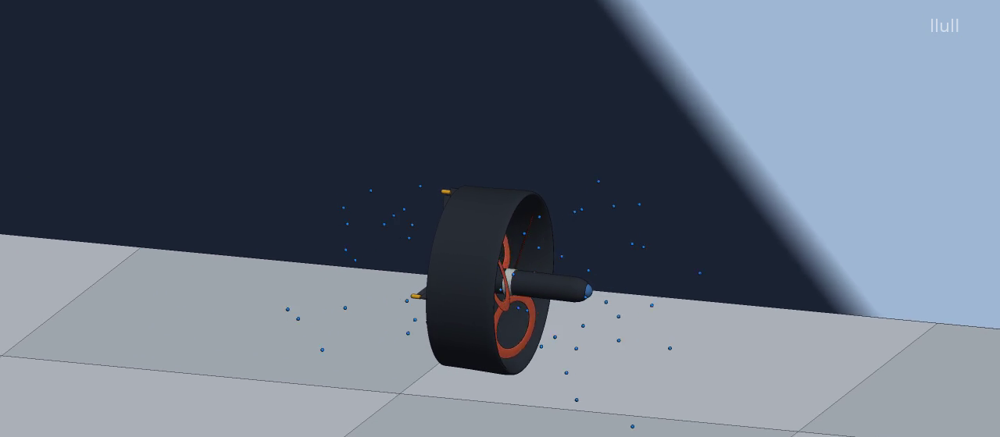
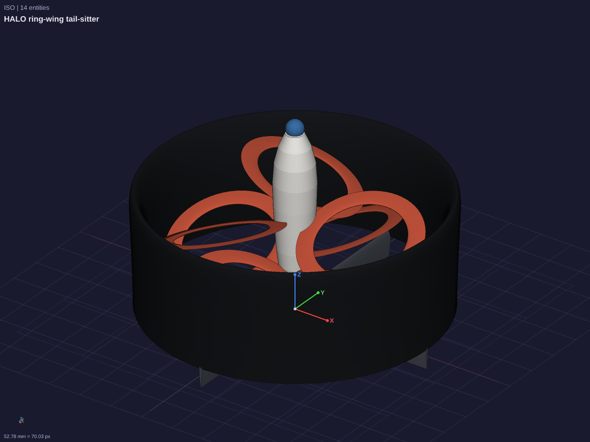
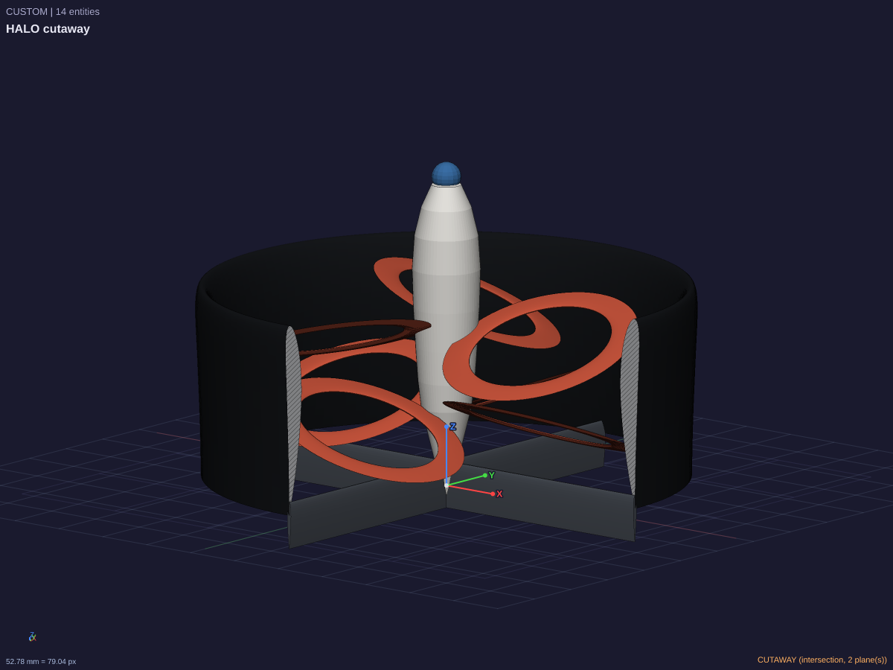
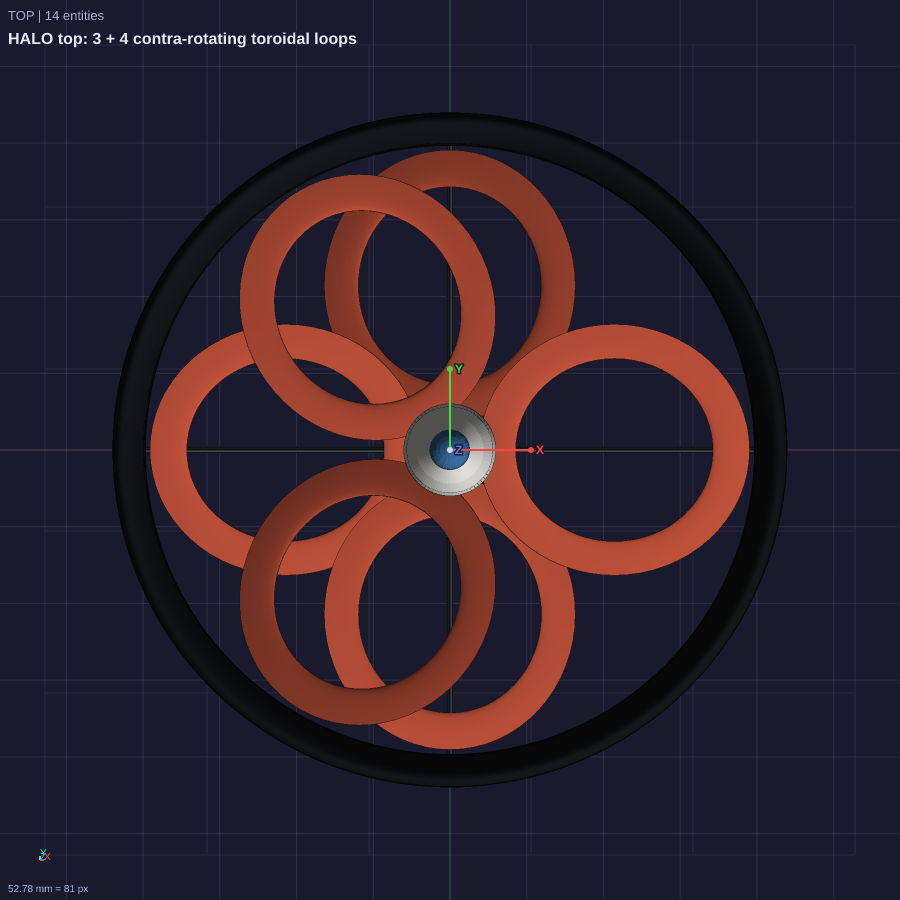

# HALO — a ring-wing, toroidal-rotor tail-sitter

## v2: production model + "how it works" film

▶ **[video/halo_how_it_works.mp4](video/halo_how_it_works.mp4)** (47 s): the parts, then a cutaway, then hover, transition, cruise and landing.

v2 (`halo_v2.lld`) replaces v1's effective-density blocks with the parts you would actually build. Every part is a
component, and every repeated part is an instance of one component, so `bill_of_materials` gives a real parts list:

| Item | Production intent (as modelled) |
| --- | --- |
| Ring wing | Hollow thin-ply CFRP shell (3 × 0.1 mm, ±45/0), the NACA 4412 duct section, 4 internal ribs at the vane stations, solid laminate close-out 8 mm ahead of the trailing edge, and one Ø2 mm pressure-equalisation vent per rib bay |
| Pod | 0.6 mm CFRP shell. The barrel laminate (`pod_barrel_layup.lld`) is 8 × 75 µm T700 thin-ply [45/−45/0/90]s on a Ø58.8 mm mandrel. It **passes llull's laminate rules** (symmetric, balanced, ply families, ±45 outer plies). The barrel weighs 42.9 g, and the ply table is in `pod_barrel_plies.csv` |
| Propulsion | Two hub motors: the stators sit inside the pod skin, and 7075 bells outside it carry the loops. The upper rotor has 3 toroidal loops and the lower rotor 4, contra-rotating. The motor air gap is 0.5 mm |
| Battery | 8 × 21700 (4S2P, 144 Wh). One layer sits between the motors and one above the avionics, which sets the CG |
| Avionics | Dual FOC ESC, H7 flight controller, GNSS / telemetry radio, camera behind a PC dome |
| Control | 4 vane struts, each with a hinged flap (`flapDeg`) driven by a linear micro servo in the tail cone |
| Landing | 4 TPU 95A feet on the struts, outboard of the flaps (`production/foot_tpu95a.3mf` is ready to print) |

**Checked in llull** (12 `check` lines in `halo_v2.lld`, all passing on the mesh kernel):
- `check_assembly` passes, with every intended joint declared (`allow_interference`, `set_part_grounded`).
- No gap is under 0.35 mm. The tightest are 0.4 mm between cells and the 0.5 mm motor air gap.
- The rotor tips clear the duct throat by 3 mm.
- The two rotors are at least 23 mm apart axially, and the lower rotor clears the struts by more than 5 mm.
- The BOM has 15 components and 35 instances.
- `check_model` is clean.

**On the exact OCC kernel** (`llull-kernel`, built here; this needed the one-line GCC fix in `surfaces.cxx`):
- The whole model rebuilds as exact B-rep, and `export_step_exact` writes `production/halo_v2.step`, a valid AP242
  assembly: 15 named parts, 35 occurrences, mm, 0 issues (`verify_exchange_file`).
- The exact mass is **1107.9 g** (`production/bom.csv`).
- Limit: the full 35-part pairwise `check_assembly` is too slow on this kernel to finish. The lower rotor alone needs
  8.6 minutes and passes, and pair classification reports `FPR_KERNEL_UNSUPPORTED`. The clearance gate therefore runs
  on the mesh kernel.

| Pitch stability (VLM, `vlm_v2.json`, CG 33.6 mm aft of the ring LE) | neutral point 48.1 mm → **static margin +8.5 %** |
| --- | --- |

`production/HALO-GA-001.svg` / `.png` is the general-arrangement drawing: an A2 sheet, first-angle projection,
1:5, with front, top, section A-A and iso views, overall dimensions and a title block. The sheet is defined in the
design itself, so it regenerates with any parameter change.

**How the film is made:** `video/renderFrames.ts` builds each of the 1128 frames by running registered commands on
`halo_v2.llull.json`: `rotate_entity` / `move_entities` place the vehicle, spin the rotors and deflect the flaps, and
`add_sphere` adds the airflow tracers. llull's own `render_view` then draws each frame, with a raster cutaway through
the ring and pod in the inside scene. `video/render.sh` renders the frames, adds the captions and encodes with ffmpeg.
The motion is choreographed, not simulated. Cruise is shown slowed down. The performance figures in the captions are
the hand estimates below.

 

---

## v1 concept

## The idea: delete the quadcopter

A quadcopter is four open propellers on four arms. It hovers well and does almost nothing else well: the arms are
dead weight, the blade tips are fast and loud, and in forward flight the whole airframe is drag with no lift. HALO
drops all of it. **One closed, annular part does four jobs:**

| Job | How the ring does it |
| --- | --- |
| Rotor duct (hover) | NACA 4412 section, camber facing **inward**: the inlet lip makes ~half the hover thrust, and the duct holds a 3 mm tip gap |
| Wing (cruise) | The craft pitches 90° and flies nose-first (+Z). A ring wing is a closed lifting system with no wing tips, so its span efficiency is about 2 (twice an ideal elliptic wing) |
| Prop guard / noise shield | No exposed blades; the rotor noise has to leave through the duct (an acoustic liner can go in the skin) |
| Landing gear | It sits on its trailing edge and the four exit vanes. Nothing extra to carry |

Inside the ring:

- **Two contra-rotating toroidal rotors** (closed-loop blades): 3 loops on top and 4 underneath. 3 and 4 are co-prime, so
  the rotor-interaction tones spread out instead of stacking up. The closed loops shed weaker tip vortices than open
  blades. Contra-rotation cancels swirl and torque, so the craft needs no stators.
- **A structural-battery pod**: 8 × 21700 Li-ion cells (≈144 Wh), coaxial motors, flight computer, and a sensor dome in
  the nose. It is moved 45 mm forward (`podZ`) so the CG sits ahead of the ring wing's neutral point.
- **Four exit vanes**: they vector thrust in hover, act as elevons and rudders in cruise, carry the pod's tail cone, and
  are the feet the craft stands on.

## Numbers

**Computed by llull** (`mass_properties`, `check_assembly`, `analyze_vortex_lattice`, `drag_buildup`, `analyze_airfoil`):

| Quantity | Value |
| --- | --- |
| Envelope | Ø 440 mm × 260 mm (ring 170 mm chord) |
| All-up mass | **1024 g**: pod (battery and avionics) 727 g, ring 187 g, 7 rotor loops 66 g, vanes 25 g, dome 15 g |
| Rotor clearance | Every rotor ≥ 2 mm from the duct, the vanes and the other rotor (`check_assembly clearanceMm=2` → pass) |
| Ring wing, VLM (576 panels) | CL_α 5.50 /rad. At α 2°: CL 0.192, CDi 0.00232 → **span efficiency e ≈ 2.0** on b = 430 mm (matches ring-wing theory) |
| Pitch stability (ring + vanes, CG x = 37.8 mm from LE) | Neutral point x = 47.5 mm → **static margin +5.7 %** (passively stable in cruise) |
| Parasite drag (ring + pod + vanes; Raymer build-up) | CD0 0.051 on S = 0.0731 m². D0 = 1.42 N at 25 m/s, 2.75 N at 35 m/s, 7.16 N at 57 m/s |
| Duct section | NACA 4412 α_L0 −4.33° (panel method) |

**First-order hand estimates** (momentum theory and the drag figures above; no llull command computes them):

| | HALO | 1 kg open quad (4 × 7") |
| --- | --- | --- |
| Hover power, ideal | 42 W (ducted, σ = 1, A = 0.117 m²) | 65 W |
| Hover power, electrical (FM 0.6 vs 0.55, η 0.85) | **≈ 82 W** | ≈ 138 W |
| Cruise | 25 m/s at L/D ≈ 6, ≈ 70 W electrical | ~15 m/s, no wing lift |
| Top speed (2 × 350 W) | **≈ 55 m/s (~200 km/h)** | ~25–30 m/s |
| Endurance (122 Wh usable) | ≈ 80 min hover, ≈ 95 min / ~145 km at 25 m/s | ~35–45 min |
| Rotor tip speed in hover | ≈ 30 m/s (CT/σ ≈ 0.08–0.1) | ≈ 75 m/s |
| Noise | roughly 15–20 dB(A) quieter at equal distance. Tip speed is 2.5× lower and tonal noise scales as ~V_tip^5–6, plus the duct shielding. Contra-rotor interaction noise counts against it | — |

How far to trust these: the hover and endurance figures are ideal-flow estimates. Expect about 60–70 % of them on a
first prototype. No acoustic, CFD or structural analysis was run. Masses use **effective densities** for the built-up
parts: ring = carbon/foam sandwich at 0.06 g/cm³, pod = packed cells and electronics at 1.5 g/cm³, foam-core loops and
vanes at 0.45 / 0.25 g/cm³. Each part needs a real layup before it counts. The llull figures are computed, not approved:
a qualified engineer has to review them before anyone flies this.

## Files

- `halo.lld`: the parametric design (one recipe step) plus 7 `check` lines. Change any parameter, e.g.
  `llull apply_design source=@text:halo.lld 'set={"ringChord":190}'`, and the model rebuilds. The checks guard the
  geometry: a 0.5 mm tip gap fails the clearance gate.
- `halo.llull.json`: the built document. Open it in the desktop app, or `llull check_design --doc halo.llull.json`.
- `vlm_ring.json`, `vlm_ring_vanes.json`, `drag_cruise.json`: analysis inputs. Run them with
  `llull analyze_vortex_lattice @vlm_ring_vanes.json` and `llull drag_buildup @drag_cruise.json` (35 m/s).
- `iso.png`, `top.png`, `side.png`, `cutaway.png`: renders.

 

## Next iterations

1. Build `llull-kernel` (OCC) and fillet the vane/ring joints; then run the exact `mass_properties`.
2. Run a `cfd_create_case` on the duct and lip in hover, to replace the σ = 1 assumption with a computed thrust split.
3. Model the rotors as `add_propeller` on revolute joints and `simulate_motion` the hover-to-cruise transition.
4. Lay up the ring as a `create_composite_part` sandwich and check `laminate_mass` against the 187 g budget.
