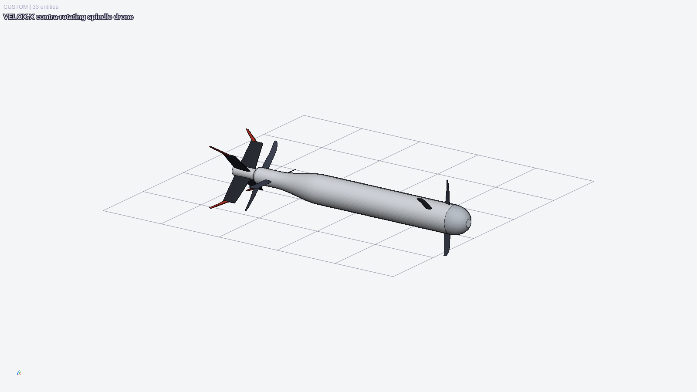
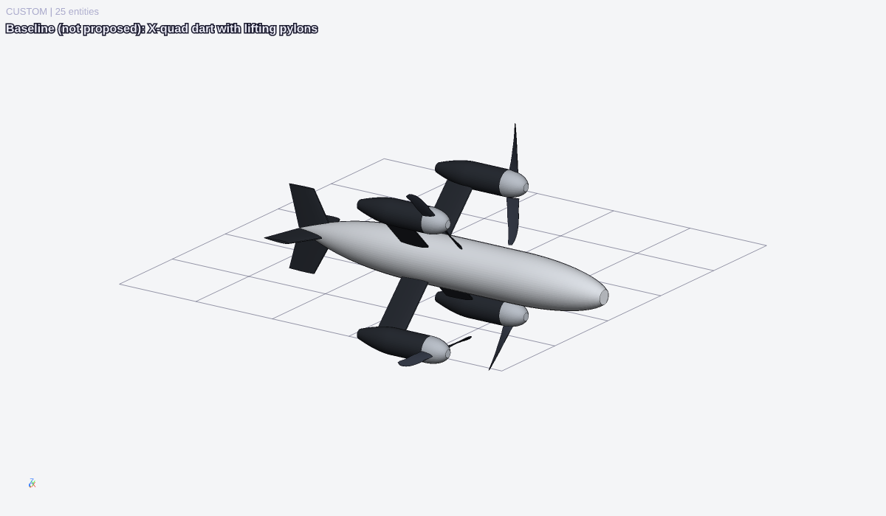
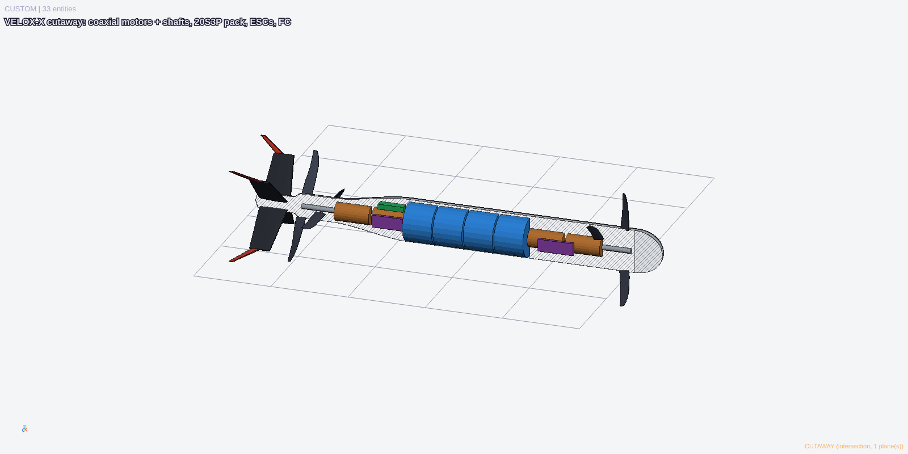

# VELOX-X: an electric contra-rotating spindle drone

**Goal:** the fastest battery-electric drone we can design, with a new layout rather than a copy of the current
speed-record quadcopters.

**Result:** VELOX-X puts all four rotors on the fuselage axis as two contra-rotating pairs: a tractor pair at the nose
and a pusher pair at the tail that ingests the fuselage boundary layer. Cruciform elevon fins sit in the slipstream.
It takes off and lands vertically, sitting on its tail.

**Predicted performance** (sea level, ISA, model grade C, uncertainty in §5.5):

- **Top speed: 976 km/h (Mach 0.80).**
- **Speed-trap average after a 2 km run-up: 889 km/h** in record mode, or 837 km/h in nominal mode.

The current Guinness record for a battery-powered RC quadcopter is 657.59 km/h. The best conventional X-quad that the
same model and the same power class can produce reaches 857 km/h.

| | |
| --- | --- |
| Length / max diameter / rotor diameter | 800 mm / 85 mm / 228.6 mm (9.0 in) |
| Take-off mass (mass budget §7) | 4.24 kg |
| Rotors | 4: two contra-rotating pairs on the axis. P/D 4.4 for the fore rotors, 4.75 for the aft rotors. 2 blades each, scimitar tips |
| Motors | 4 × 36 × 68 mm inrunners, 360 g, Kv 750, 5.5 kW shaft each (burst) |
| Battery | 20S3P, 1050 mAh high-rate LiPo pouches: 233 Wh, 74 V, 420 A burst |
| Power at top speed | 23.8 kW electrical, 20.6 kW shaft, propulsive efficiency 0.67 |
| Drag area | 11.3 cm² (an X-quad needs about 18 cm²) |
| Launch thrust / weight | 2.1 at the 4.14 kg modelled mass, 2.06 at the 4.24 kg budget mass (vertical launch from its own landing toes) |
| Full-power time per run | about 21 s; one run uses 83 % of the pack in record mode |

This folder is a complete **design package for building and qualifying a prototype**. It contains the parametric CAD,
the performance models, the trade studies, the specifications, the mass budget, the manufacturing route, and the test
gates. It is not yet a frozen production configuration. Production release (§10) follows the qualification tests in
§9, because several key inputs, such as cell C-rate, motor Km and blade aerodynamics at J ≈ 4.5, are grade C until
tested.

---

## 1. Research: where the speed record is, and what limits it

**State of the art.** The Guinness record for the fastest battery-powered RC quadcopter is **657.59 km/h**. It is held
by Luke and Mike Bell's Peregreen V4 (Cape Town, 11 December 2025, mean of two opposite-direction runs). The previous
marks were:

- Ben Biggs's Blackbird: 626 km/h official, and an unofficial telemetry claim of about 685 km/h.
- Peregreen 3: about 585 km/h.
- Peregreen 2: about 480 km/h.

Published hardware for these drones:

- **Layout:** a 3D-printed fuselage with four tractor motors on short arms, flown nose-down, with AirShaper-refined
  fairings and motor spinners. Spinners alone were worth about 30 km/h.
- **Motors:** T-Motor 3120-class at 800–900 Kv.
- **Props:** 6–7 in props.
- **Power:** about 16 kW peak.
- **Battery:** water-cooled.

Sources are listed at the end.

**The physics of the limit.** In level flight, P_shaft · η_prop = D · V and D = ½ρV²·CdA. Top speed therefore scales
as (η·P / CdA)^(1/3), and three levers matter:

1. **Drag area.** On a record quad, the four motor pods, four arms and their junctions are more than half of the drag.
   The fuselage itself is a small part (§3, table).
2. **Propeller efficiency at J ≈ 4–5.** A 6 in prop at 650 km/h runs with helical tip Mach above 1. The blades must be
   pitched far beyond normal (P/D > 3) to stay unstalled at speed, yet still lift the drone off the ground.
3. **Power the battery can deliver for about 20 s,** and the heat that results in the cells and motors.

A fourth factor that is easy to miss: **a quad carries its weight with its rotors**. At 650 km/h a 3 kg quad must tilt
its thrust about 30° off the flight path, which adds about 15 % to the thrust it needs (§2).

## 2. Baseline first: how far the conventional X-quad can go

The conventional layout was modelled and optimised first so that the new concept is judged against the best version of
the old one, not a straw man. The baseline is `baseline_xquad.lld` plus `study/velox_model.py` and `study/sweep.py`:

- an X-quad tail-sitter dart;
- four tractor pods on pylons;
- **lifting pylons**, our first improvement: the pylons carry the weight at speed, so thrust aligns with the flight path;
- ultra-high-pitch scimitar props;
- inrunner motors.

The sweep covered 1,575 designs: a 375-point first pass, then 1,200 points with motor scaling and thermal limits
(the second pass is in `study/sweep_results.csv`). Variables were prop diameter, pitch ratio, Kv, motor size and pack, under constraints of static
T/W ≥ 2.2, motor ΔT ≤ 75 K and pack ΔT ≤ 30 K. The best feasible point reaches **857 km/h asymptotic at 22.7 kW**.
With the same physics, that is already well above the 657.59 km/h record. The remaining drag (18 cm²) is dominated by
the pods and pylons. Removing them requires a different architecture.

## 3. The invention: VELOX-X

VELOX-X combines six design ideas. Each attacks one term of (η·P / CdA)^(1/3) or one of the practical limits.

1. **All four rotors on the axis, as two contra-rotating pairs.** The nose pair (N1, N2) pulls and the tail pair
   (T1, T2) pushes. There are no pods, no pylons and no pod junctions. The drag area falls from about 18 cm² to
   11.3 cm².
2. **Swirl recovery.** The aft rotor of each pair meets the fore rotor's swirl head-on. That swirl energy, about 3–6 %
   of shaft power at P/D 4+, is lost on an isolated propeller. The aft rotors are pitched 0.35 P/D higher because they
   also see the fore rotor's slipstream.
3. **Boundary-layer ingestion (BLI) at the tail pair.** The tail rotors work on the slow fuselage boundary layer. This
   is counted conservatively: a 4 % inflow deficit, and the thrust is credited at flight speed.
4. **Gyroscope-free attitude control.** Matched contra pairs carry almost zero net angular momentum, so there is no
   gyroscopic coupling between pitch and yaw. Roll about the long axis comes from the torque split inside each pair,
   with authority of about 570 rad/s².
5. **Slipstream elevons and landing toes on the fins.** Four X-layout fins sit on a short boom behind the tail pair, in
   the combined slipstream of both pairs: about 38 m/s at hover.
   - **Hover:** their elevons give pitch and yaw authority of about 11 rad/s². This is how VTOL tail-sitters such as
     the Convair Pogo were controlled.
   - **Speed:** the same fins give stability and trim, and carry the weight (§5.3).
   - **Landing:** thin CFRP toes on the fin tips reach past the rotor disks and are the landing feet.
6. **Transonic scimitar blades at P/D ≈ 4.4.** The blades use a constant-pitch helix with 30° cubic tip sweep and a
   thickness ratio thinning from 12 % to 5.5 %. The helical tip Mach number is 0.98; the Mach number normal to the
   leading edge is about 0.85. The design rpm keeps wave drag low: the BEMT uses the Korn equation with Lock's wave
   drag (§5.1).

The cooling scheme is also new. Ram air enters an annular gap behind N2, which the nose pair pressurises. It flows over
the ESCs, the motors and the 1.5 mm channels between battery cells, then leaves through the tail-pair hub into the tail
rotors' inflow, where it partly refills the boundary layer.

| CdA breakdown at top speed (cm²) | X-quad baseline | **VELOX-X** |
| --- | ---: | ---: |
| Fuselage | 3.6 | 5.1 (longer, holds four motors) |
| Pods ×4 | 4.7 | none |
| Pylons ×4 | 1.9 | none |
| Fins / toes | 1.5 | 2.1 + 0.4 |
| Interference | 1.8 | 0.4 |
| Cooling | 3.2 | 2.6 |
| Misc. (+6 %) | 1.0 | 0.6 |
| **Total** | **≈17.7** | **11.3** |

**Category note.** VELOX-X has four rotors and hovers like a multirotor, but it is not a conventional quadcopter. A
record would most likely be filed in an RC electric aircraft or VTOL category. For the Guinness "quadcopter" category,
the baseline (§2) is the design to build.

## 4. Design process: research, invention, refinement

| Step | What | Where |
| --- | --- | --- |
| Validate the prop model | BEMT vs UIUC APC 10×4.7: static Ct within 10 %, peak η 0.63 vs 0.67 measured | `study/velox_model.py` |
| X-quad sweep | 1,575 points, then thermal limits and motor-size scaling. Best 857 km/h | `study/sweep.py`, `sweep_results.csv` |
| Invent the inline layout | Contra pairs + swirl recovery + BLI model | `study/velox_inline.py` |
| Inline sweep | 288 points: D, P/D, Kv, motor mass, pack. Best feasible 975–983 km/h | `study/sweep_inline.py`, `sweep_inline_results.csv` |
| Local refinement | Aft pitch delta, Kv 600–750 (`refine_inline.py`), then Kv 350–750 at both ESC limits (`refine_kv.py`) | `study/refine_*.py` |
| Fix the gimbal | A tail gimbal can't coexist with tail-sit landing, so it was replaced by slipstream elevons and toes | §3 item 5 |
| Pack packaging | The 20S3P pack needs 240 mm of bay, so the fuselage grew from 760 to 800 mm and all numbers were re-run | `study/final_point.py` |
| Run-up profile | V_max is approached slowly, so the record metric is the speed-trap average after a fixed run-up | `study/course.py` |
| Pitch trim | Fixed fin incidence was wrong: the Munk moment sets α ≈ 2.6°, fins at 0° incidence, elevon trim −0.85° | §5.3 |
| Shaft dynamics | The first inner shaft (Ø8 Ti solid) had a critical speed of 23.9k rpm, below the 22.4k rpm static speed plus margin. Changed to a Ti tube 10/7: 36.5k rpm | §6.3 |
| Independent check | llull `run_flight` (MuJoCo) at top speed with installed rotor tables | §5.4 |

Decisions the data drove:

- **20S3P over 20S2P.** 28 K vs 40 K pack heating, 71 % vs 83 % energy used, at 0.3 kg more mass.
- **Kv 750 at a 253 A ESC limit.** Kv 350–550 reaches the same ~975 km/h but becomes pack-current limited at 28–29 kW
  (more pack heat) and loses launch thrust.
- **D 9 in, P/D 4.4.** Larger or higher-pitched props gain less than 1 % and lose launch T/W.

## 5. Performance

### 5.1 Methods

| Element | Method |
| --- | --- |
| Rotors | BEMT: Prandtl tip loss, swirl, PG lift slope, Clmax(M), stall model, Korn drag divergence + Lock 20(M−Mcr)⁴ wave drag, simple-sweep theory |
| Motors | DC model of a BLDC: Km ∝ mass^1.25 (reference 205 g / 0.063 N·m/√W hot), iron loss ∝ rpm |
| ESC | Constant efficiency, duty ≤ 0.97 |
| Battery | Pack OCV − R·I, burst current limit per cell |
| Drag | Raymer component build-up (turbulent Cf with compressibility, form factors, Prandtl-Glauert on the pressure part), interference, cooling and misc adders |
| Fin lift | Induced drag with Oswald 0.9 |

### 5.2 Design point (top speed, `study/final_point.json`)

| | N1 | N2 | T1 | T2 |
| --- | ---: | ---: | ---: | ---: |
| rpm | 16,205 | 14,596 | 15,726 | 14,366 |
| Thrust (N) | 11.4 | 11.3 | 14.8 | 13.7 |
| Shaft power (W) | 5,455 | 4,948 | 5,318 | 4,853 |
| Phase current (A) | 253 | 253 | 253 | 253 |

| Quantity | Value |
| --- | --- |
| Drag | 51.1 N |
| Fin lift | 40.6 N (= weight) |
| Bus | 73.4 V, 324 A, 23.8 kW (motor-current limited) |
| Launch (static) | T/W 2.11: rotors at 22.4k / 18.4k rpm, 423 A, 31 kW for about 2.5 s |
| Motor loss | 0.70 kW per motor, η 0.88, ΔT 34 K over a 21 s run (ram-air cooled) |

### 5.3 Pitch trim and stability (hand calculation, mass budget CG at x = 412 mm)

| Moment term | Value at q = 45.2 kPa |
| --- | --- |
| Slender-body Munk moment | 2qαV_body = 313 N·m/rad (destabilising) |
| Fin lift slope (X fins, S_eff = 0.0078 m², CLα ≈ 3.6) | 1,266 N/rad |
| Fin restoring moment (arm 0.367 m) | 465 N·m/rad |

- **Statically stable:** static margin ≈ 0.12 m (15 % of length).
- **Trim:** α = 2.6°, fin lift 38.6 N, elevon trim −0.85°. Body cross-flow drag at that angle adds about 1.6 cm². This
  is not in the drag table; it costs about 0.5 % of speed.
- **Hover authority:** about 11 rad/s² in pitch and yaw from the elevons; about 570 rad/s² in roll from a ±20 % torque
  split.

### 5.4 Run profile and independent cross-check

`study/course.py` simulates a 2.5 s vertical launch, then a level run-up from 40 m/s and a 1 km speed trap:

| Mode | 1 km | 2 km | 3 km | **Trap mean** | Energy | Pack ΔT (adiabatic) |
| --- | ---: | ---: | ---: | ---: | ---: | ---: |
| Nominal (220 A) | 635 | 806 | 889 | **837 km/h** | 71 % | 28 K |
| **Record (253 A burst)** | 649 | 849 | 933 | **889 km/h** | 83 % | 42 K |

**Record mode** requires all of the following:

- the pack conditioned to 20 °C;
- the ram-air plenum validated in test T-04b;
- BMS abort at 60 °C cell temperature.

**llull cross-check** (`velox_x_dash.plan.json`, results in `study/llull_dash_check.txt`):

- **Setup:** the vehicle is a free rigid body in llull's MuJoCo flight physics (`run_flight`) at 271.1 m/s.
  - The four rotors are held at the design rpm and use *installed* Ct/Cp(J) tables exported from the BEMT.
  - Body drag is set to the modelled CdA, and fin lift is applied as a load.
- **Speed:** the vehicle holds 271.3 m/s mean over 0.5 s.
- **Agreement:** thrust 54.4 N vs drag 51.1 N, and shaft power 21.3 kW vs 20.6 kW from the BEMT. The two agree within
  6 %.

### 5.5 Uncertainty

| Input | Uncertainty | Effect on speed |
| --- | --- | --- |
| Drag | ±20 % | ∓6–7 % |
| Rotor efficiency | ±10 % | ±3.5 % |
| Cell sag | ±20 % R | ±1 % |

The combined band is about ±8 %: top speed 900–1,050 km/h and trap mean 820–960 km/h. Even the pessimistic end beats
657.59 km/h by more than 25 %.

## 6. Subsystem specifications

### 6.1 Airframe (`velox_x.lld`, all parametric)

**Fuselage.** A Myring-style body of revolution, 800 mm long and 85 mm in diameter, made up of these sections:

- boom, Ø32;
- tail-pair hub, Ø48;
- cubic boat-tail, 150–300 mm;
- battery bay, 300–540 mm;
- nose-motor bay;
- elliptic nose spinner, 55 mm.

**Shell.** CFRP prepreg (T700/epoxy): 2 × 200 g/m² twill at ±45°, plus 0° UD strips in the bay. Average thickness is
0.8 mm, over a measured area of 0.175 m². The shell is split along the XZ plane and has a top battery hatch.

**Fins.** Four in an X layout, NACA 0008:

- root chord 55 mm, tip chord 40 mm;
- tip at 0.85 R (97 mm), inside the hover slipstream;
- 30 % elevons on Kevlar hinges;
- CFRP skins over a Rohacell 71 core.

**Toes.** Four streamlined CFRP rods (6 × 3 mm section) with TPU pads. They reach R + 14 mm, 15 mm below the boom end,
and give a four-point tail-sit stance.

### 6.2 Rotors

**Geometry**

| Parameter | Value |
| --- | --- |
| Diameter | 228.6 mm |
| Blades | 2 per rotor |
| Pitch | constant-pitch helix: P/D 4.4 (N1, T1), 4.75 (N2, T2) |
| Chord | 0.13 R at 0.75 R, elliptic-taper planform |
| Section | NACA 4-digit thickness on a 2 % camber line |
| Thickness ratio | 12 % at the root, 5.5 % at the tip |
| Tip sweep | 30°, cubic from 0.55 R |
| Hub ratio | nose 0.35, tail 0.19 |

**Build**

- **Blades:** compression-moulded T800 UD + ±45 skins in matched CNC steel moulds (±0.02 mm), with a nickel
  leading-edge strip.
  - Root load at design: about 0.43 kN centrifugal + about 0.7 N·m bending, giving 20 + 110 MPa. The static safety
    factor is above 5.
  - Blades are mass-matched to ±0.05 g.
- **Hub:** 7075-T6 split hub, balanced to ISO 21940 G1.0.
- **Rotation:** nose and tail pairs each run CW + CCW. The fins sit downstream of the tail pair, so no blade passes through a fin wake.

### 6.3 Drivetrain

**Motors.** Four 4-pole inrunners, 36 × 68 mm active, 360 g each:

| Parameter | Value |
| --- | --- |
| Kv | 750 |
| Km (hot) | ≥ 0.127 N·m/√W |
| R (hot) | ≈ 10 mΩ |
| Peak current | 253 A for 25 s |
| Shaft power | 5.5 kW |
| Rotor | N52H magnets, carbon retaining sleeve, rated 30k rpm |

These motors are in the F5D/F3S pylon-racing class. The datasheet must be confirmed on the dyno (T-03).

**Coaxial shafts.**

| Part | Spec | Dynamics / loads |
| --- | --- | --- |
| Inner shaft (to the far rotor) | Ti-6Al-4V tube 10/7 | First bending critical 36.5k rpm, ≥ 1.6× the 22.4k rpm static maximum |
| Outer shaft (to the near rotor) | CFRP tube 16/13 | — |
| Bearings | Hybrid ceramic angular-contact (Si₃N₄ balls), grease | Thrust ≤ 22 N per rotor, so lightly loaded |
| Bearing cartridges | 7075, one at the nose and one at the tail | — |

### 6.4 Electrical

**Battery.** 20S3P of 1050 mAh, 150C-class LiPo pouches (60 cells), 233 Wh.

- Assembly: 4 modules of 5S3P in stepped stacks with 1.5 mm cooling channels and laser-welded Ni-plated Cu bus bars.
- Monitoring: 12 thermistors and balance taps feeding the BMS logger.
- Main connection: 2 × AS150U in parallel.

**ESCs.** Four single-channel FOC units:

- 150 V MOSFETs (20S is 84 V maximum);
- 253 A phase burst / about 85 A DC;
- 48 kHz PWM;
- CAN/DShot;
- mounted in the cooling annulus.

**Avionics.**

- **Flight controller:** H7 class with dual IMU and an RTK-GNSS antenna in the GFRP boom cap.
- **Telemetry:** 900 MHz.
- **Safety:** independent flight-termination receiver (§11).

### 6.5 Control and flight modes

| Mode | Collective | Roll (long axis) | Pitch / yaw |
| --- | --- | --- | --- |
| Launch / hover (tail-sit) | 4 rotors | CW/CCW torque split | Elevons in the slipstream |
| Transition (pitch-over at 40 m/s) | 4 rotors | Torque split | Elevons |
| Dash | 4 rotors | Torque split | Elevons; static stability from the fins |
| Recovery | Decelerate, pitch up to vertical, hover descent onto the toes | | |

**Firmware.** Base: an ArduPilot QuadPlane tailsitter of the control-surface type, with a custom mixer for the
torque-split roll axis.

**llull gap found.** llull's `add_flight_controller` mixes rotors only and refuses a rotor layout without pitch/yaw rank
(`FLT_MIXER_RANK`). Closed-loop simulation of this vehicle needs an aero-surface (elevon) mixer in llull. This is a
candidate `add-command` task.

## 7. Mass budget (`study/mass_budget.json`)

| Item | Group | g | x (mm) |
| --- | --- | ---: | ---: |
| Fuselage shell CFRP 0.8 mm (0.1752 m² measured in llull) | structure | 217 | 451 |
| Nose spinner GFRP 0.6 mm (0.0193 m² measured) | structure | 22 | 766 |
| Fins ×4 CFRP over Rohacell (4 × 10.4 cm³ measured) | structure | 40 | 40 |
| Landing toes ×4 | structure | 10 | 9 |
| Frames ×5 + battery rails | structure | 70 | 420 |
| Bearing cartridges ×2 | structure | 50 | 410 |
| Motor bulkheads ×4 + mounts | structure | 48 | 420 |
| Battery hatch, latches, fasteners | structure | 40 | 420 |
| Structure contingency (10 %) | structure | 45 | 420 |
| Motors ×4 (MN2, MN1, MT1, MT2) | propulsion | 1,440 | 648 / 574 / 194 / 268 |
| Rotors ×4 | propulsion | 136 | 730 / 690 / 140 / 100 |
| Coaxial shafts | propulsion | 90 | 420 |
| Battery 20S3P | energy | 1,647 | 420 |
| ESC ×4 | avionics | 140 | 434 |
| FC + RX + telemetry | avionics | 60 | 270 |
| GNSS + antennas (boom cap) | avionics | 10 | 10 |
| Elevon servos ×4 | avionics | 48 | 45 |
| Wiring, bus bars, connectors, BMS taps | avionics | 122 | 420 |
| **Total** | | **4,235** | **CG 412** |

Inertia: Ixx = 0.0023 kg·m², Iyy = Izz = 0.113 kg·m².

The performance runs used 4.142 kg. The +2 % in the budget, mostly from shafts resized after the critical-speed check,
changes top speed by less than 0.3 %: weight only enters through fin induced drag and acceleration.

## 8. Manufacturing and assembly

| Part | Process | Tooling | Inspection |
| --- | --- | --- | --- |
| Fuselage halves, boom | Prepreg layup, OOA cure at 120 °C | CNC aluminium female moulds (3D-printed high-temp for EVT) | Thickness, mass, CT scan of the bay frames |
| Spinner | GFRP prepreg | Aluminium mould | Mass, runout ≤ 0.05 mm |
| Blades | Compression moulding | Matched steel moulds, 2 sets (fore / aft pitch), each with CW + CCW cavities | CMM sections at 5 stations, mass match ±0.05 g, 100 % visual + tap test |
| Hubs, cartridges, bulkheads | 5-axis CNC 7075-T6 | — | CMM on bearing seats (IT5) |
| Shafts | Ti tube ground; CFRP tube roll-wrapped + ground | — | Runout ≤ 5 µm, rap test (critical speed) |
| Fins + elevons | CFRP skins over CNC Rohacell, Kevlar hinge | Aluminium moulds | Hinge moment, mass |
| Battery modules | Cell grading (DCIR ±3 %), laser-welded bus bars, potting of taps | Welding jig | 100 % DCIR, IR thermography at 10 s pulse |
| ESCs | 4-layer 2 oz PCB, conformal coat | — | Burn-in at 253 A pulse |

**Assembly sequence**

1. Bond frames and cartridges into the lower shell.
2. Fit the motors, shafts and bearings (pre-load set).
3. Balance each rotor pair in place (G1.0).
4. Fit the ESCs and wiring loom.
5. Close the upper shell.
6. Fit the boom, servos and fins.
7. Fit the battery and close the hatch.
8. Run the full-system rotor run-up on the restrained stand (T-08).

## 9. Qualification gates (before any speed flight)

| Gate | Test | Pass criterion |
| --- | --- | --- |
| T-01 | Rotor thrust stand (static) + car-top rig to 60 m/s + flight-test calibration of the J > 3 data | Static T/W ≥ 2.0; model re-fit |
| T-02 | Whirl / spin pit, blades at 115 % max rpm (25.7k) for 5 min; burst at 130 % | No damage; tip deflection inside the predicted range; no flutter |
| T-03 | Motor dyno: Km, R, I0; 3 × (253 A × 25 s) | Km ≥ 0.127 hot; winding ≤ 140 °C |
| T-04 | Cell qualification: 140 A/cell × 25 s pulses × 20 cycles. T-04b: pack in the plenum at 270 m/s-equivalent airflow | Sag within model ±10 %; ΔT ≤ 35 K |
| T-05 | ESC at 85 V bus, 253 A phase, transients | No over-voltage above 120 V; FET ΔT within limit |
| T-06 | Shaft critical speed and bearing run-in | f₁ ≥ 1.5 × 22.4k rpm |
| T-07 | Structure: fuselage bending at 1.5 × limit (5 g at 270 m/s), fin + toe drop test | No failure; deflection as predicted |
| T-08 | Restrained full-power run-up (stand) | Thermal and vibration within limits; FTS functional |
| T-09 | Hover, transition and envelope expansion: 400 → 550 → 700 → 800 → 900 km/h | Model within ±5 % at each step before the next |
| T-10 | Record-procedure rehearsal | Two-way runs inside the rule time window |

## 10. Path to production

- **Configuration freeze** at EVT: one airframe built after T-01 to T-08.
- **DVT:** three airframes through T-09 with the model re-fitted after each step.
- **PVT:** a production lot of 10 (moulds proven, Cpk ≥ 1.33 on blade sections, cell grading yield).

The parametric design (`velox_x.lld`) regenerates the whole geometry from about 40 parameters when a test result moves
a size.

## 11. Safety, regulation and risks

**Kinetic energy at speed is about 155 kJ.** Flights take place only on a closed range with a ground-risk buffer,
operated under specific-category authorisation (EU: SORA operational authorisation from the national CAA; US: a
waiver, since Part 107 caps speed at 100 mph). The flight-termination system cuts all four ESCs over an independent
link.

| Risk | Mitigation |
| --- | --- |
| R1: cells cannot hold about 103–133C for 21 s | T-04. Fall-backs: 20S4P (+0.55 kg, about −2 % speed), or Li-ion power cells |
| R2: static stall of the P/D 4.4 blades lowers launch T/W | T-01. Fall-backs: launch from a rail, or Block 2 variable pitch (also improves the run-up) |
| R3: transonic blade flutter or erosion | Whirl test T-02, thin-tip stiffness, nickel leading edge |
| R4: model error at J ≈ 4.5 | Envelope expansion T-09 with re-fit at each step |
| R5: pack heating in record mode | 20 °C pre-conditioning, plenum test T-04b, BMS abort at 60 °C |

## 12. Files

| File | What |
| --- | --- |
| `velox_x.lld` | The VELOX-X design: parametric llull design language, 34 entities, 5 checks. Apply it with `node server/bin/llull.cjs apply_design source=@text:designs/velox/velox_x.lld --doc velox.json` (or `--app`) |
| `baseline_xquad.lld` | The X-quad baseline (§2) |
| `velox_x_dash.plan.json` | llull flight cross-check (rigid body, 4 rotors with installed tables, drag, fin lift). Run `llull run` on it, then `llull run_flight scenario=dash` |
| `renders/` | Views rendered by llull `render_view` |
| `study/` | Performance models (`velox_model.py`, `velox_inline.py`), sweeps, refinement, final point, run profile, mass budget, JSON results |
| `export/` (not committed) | STL of the outer mould line, 3MF assembly, CadQuery script. Regenerate with `export_stl` / `export_3mf` / `export_code` on the applied design |

STEP export needs llull's native OCCT kernel (`cargo build --release` in `solver/`). It was not built in this session,
so the bodies here are mesh-kernel geometry.

## Sources

- [Guinness-verified 657.59 km/h, Peregreen V4 (Elektor)](https://www.elektormagazine.com/news/worlds-fastest-drone-guinness)
- [Peregreen V4 at 408 mph (New Atlas)](https://newatlas.com/drones/luke-mike-bell-peregreen-v4-guinness-speed/)
- [Fully 3D-printed 408 mph drone (Tom's Hardware)](https://www.tomshardware.com/3d-printing/fully-3d-printed-drone-capable-of-flying-at-408-mph-is-the-fastest-in-the-world-father-son-duo-reclaim-guinness-world-record-title-with-diy-quadcopter)
- [Peregreen V4 record (Militarnyi)](https://militarnyi.com/en/news/fastest-quadcopter-peregreen-v4-sets-world-record/)
- [Peregreen 3, 585 km/h, 16 kW, water cooling (heise)](https://heise.de/-10908286)
- [Peregreen V4 hardware (Notebookcheck)](https://www.notebookcheck.net/DIY-engineers-3D-print-drone-with-408-mph-top-speed-breaking-a-Guinness-World-Record.1205284.0.html)
- [Fastest drones 2026 overview, Blackbird figures (AeroCorner)](https://aerocorner.com/blog/fastest-drones/)
- [How Peregreen 2 was built (Geeky Gadgets)](https://www.geeky-gadgets.com/how-the-new-worlds-fastest-drone-was-built-peregreen-2/)

Methods: Raymer, *Aircraft Design: A Conceptual Approach* (drag build-up); Mason, *Configuration Aerodynamics* (Korn
equation); Glauert / Prandtl (BEMT, tip loss); UIUC Propeller Database (APC 10×4.7 validation); Munk (slender-body
moment).
